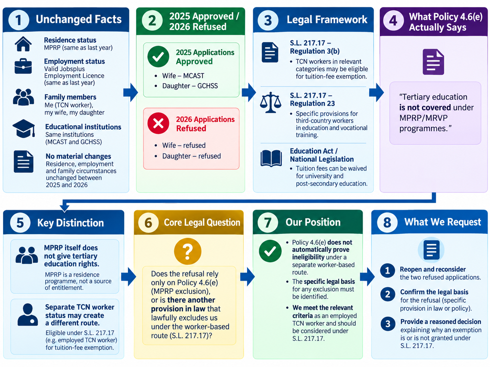
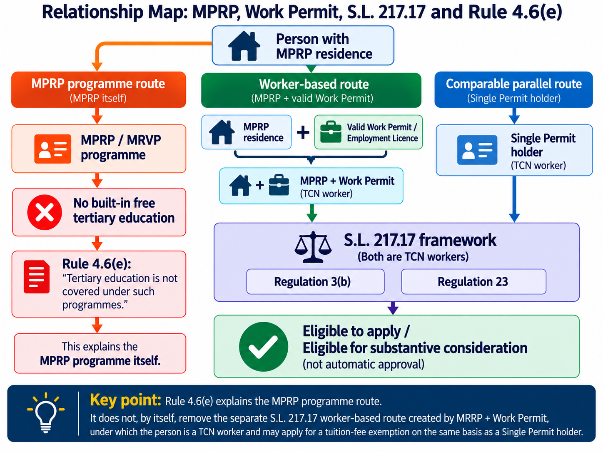
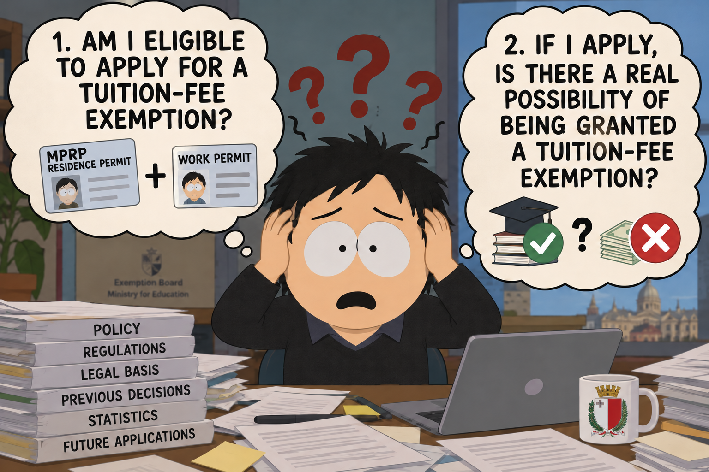
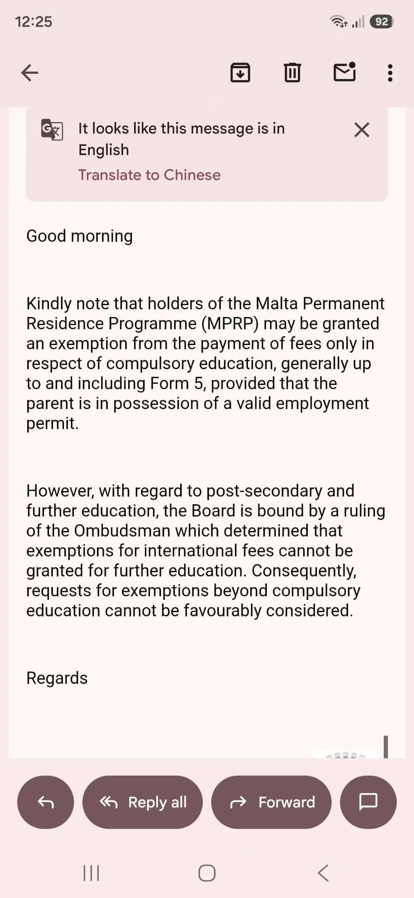
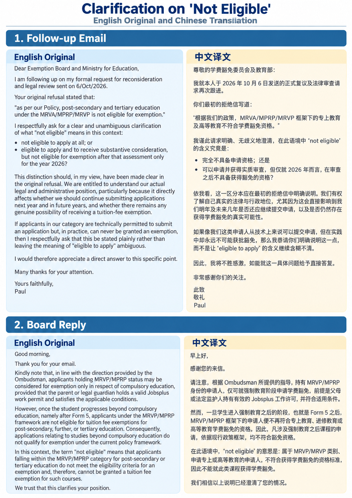
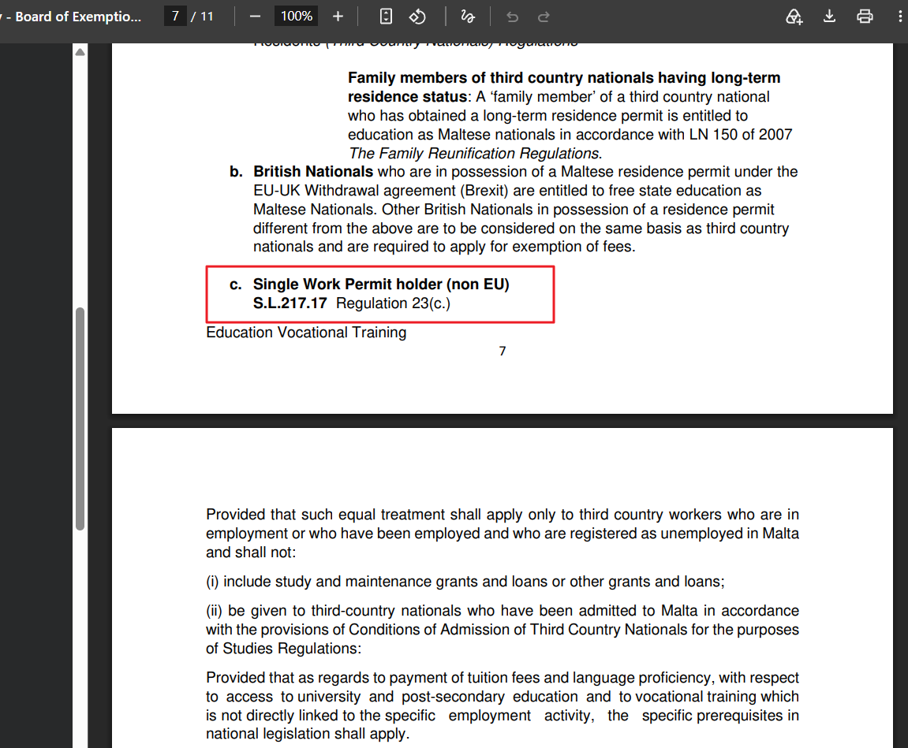
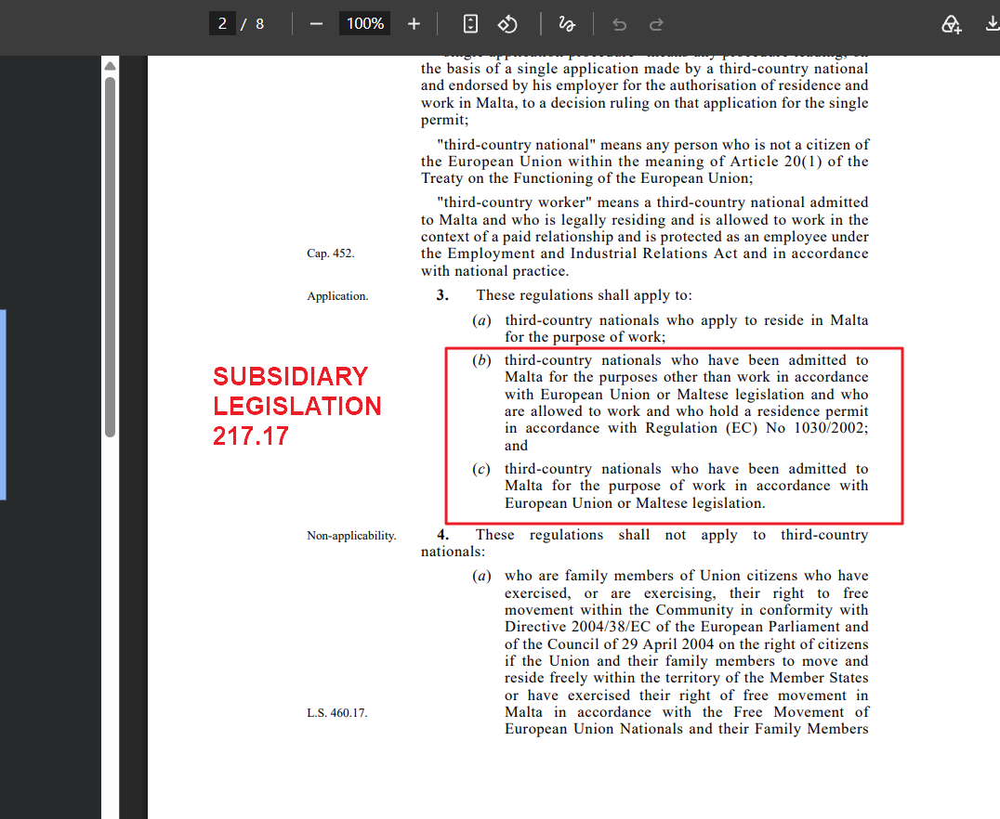

education.meyr@gov.mt,
Exemptions Board at MES <exemptionsboard.mes@gov.mt>,
Mifsud Deborah at MES <deborah.d.mifsud@gov.mt>,
Borg Vincent at MES <vincent.e.borg@gov.mt>

clientrelations.residencymalta@gov.mt

# Formal Reconsideration Request – Tuition-Fee Exemption Eligibility and Legal Basis

Dear Exemption Board and Ministry for Education,

I, Dongcheng WANG (ID 482971A, MPRP Holder), hereby submit this formal request for reconsideration and legal review of the decisions refusing the tuition-fee exemption applications submitted on behalf of my wife, Yingchun LIU (ID 482968A), and my daughter, Xi WANG (ID 482972A).

For the avoidance of doubt, the argument set out below **does not rely on our MPRP residence status as the source of any entitlement to free education**. It relies solely on **my separate status as a third-country national worker lawfully residing and working in Malta**.

## Statement of facts:

- Last year, I submitted two applications for tuition-fee exemptions:

    - Form EST-036134-OOM6M for my wife, Yingchun LIU, to study at MCAST, was submitted on 26 September and approved on 13 October 2025.

    - Form EST-036180-8FYIW for my daughter, Xi WANG, to study at GCHSS, was submitted on 28 September and approved on 10 October 2025.

- This year, I likewise submitted two applications:

    - Form EST-058986-80SLX for Yingchun LIU was submitted on 20 September 2026 and refused on 2 October 2026, with the refusal stating that *as per our Policy, post-secondary and tertiary education under the MRVA/MPRP/MRVP is not eligible for exemption*.

    - Form EST-058985-V8OF3 for Xi WANG was submitted on 20 September 2026 and refused on 22 September 2026, with the same reason.

Between the 2025 and 2026 applications, the material residence, employment and family circumstances relevant to the exemption remained unchanged. Our residence status remained the same, my employment status remained the same, and the applications concerned the same educational institutions.

## Position

An MPRP beneficiary who is lawfully resident in Malta and separately authorised to work appears to fall within the category contemplated by **Regulation 3(b) of `S.L.217.17`**, subject to the statutory conditions set out therein.

If the Board considers that an MPRP residence permit combined with a valid Jobsplus Employment Licence does not satisfy the conditions of Regulation 3(b), I respectfully request that the precise legal basis for that conclusion be identified.

Regulation 23 then provides, subject to the conditions and limitations stated therein, for equal treatment of the relevant third-country workers with Maltese nationals in, among other matters, education and vocational training.

For university and post-secondary education, the same legislation allows specific prerequisites concerning tuition fees to be imposed by national legislation.

The decisive question is therefore not whether MPRP itself grants free education. It plainly does not.

The decisive question is whether Maltese national legislation contains any provision that lawfully permits a TCN worker holding MPRP residence status and a valid Employment Licence to be **excluded from eligibility to apply for, or to be considered for, a tuition-fee exemption** solely because the underlying residence permit derives from MPRP rather than from the Single Permit procedure.

**This submission concerns eligibility to apply and to receive substantive consideration. It does not assert an automatic entitlement to approval.**

If the Board’s position is that MPRP beneficiaries with valid Employment Licences are formally eligible to apply, and that each refusal results from an individual exercise of discretion, then the actual decision-making process becomes highly relevant. Where applications are refused within a matter of minutes, using the same categorical reason, and materially comparable applicants appear to receive the same outcome, it is difficult to reconcile that practice with a genuine case-by-case substantive assessment.

In those circumstances, the distinction between “eligible to apply” and “not eligible for exemption” risks becoming merely formal, while the purported exercise of discretion risks functioning in practice as a categorical exclusion. If the outcome is effectively predetermined by residence category, then describing the process as one of individual discretion does not answer the underlying concern.

In that situation, the material question remains the same: what statutory provision lawfully renders that entire category substantively ineligible, irrespective of the individual merits of the application?

I do not make this submission lightly, and I would prefer to be shown that my conclusion is wrong.

However, on the basis of the legislation, published Government information, the Board’s own policies and the previous administrative decisions available to me, I am presently led to the following conclusion.

To date, no such statutory provision has been brought to my attention.

Instead, the exclusion appears to arise from the Board’s administrative policy, namely ***the Policy and Rules of Procedure for the Exemption of Fees of State Education Institutions*** (Revised June 2023, hereinafter referred to as the `Policy`).

However, `Rule` 4.6(e) itself requires an important distinction to be made.

I fully accept the statement in `Rule` 4.6(e) that tertiary education is not covered under the MPRP programmes. **I do not rely on MPRP as the source of any entitlement to tertiary education.** However, that is not the legal basis on which this request is made. `Rule` 4.6(e) addresses the treatment available under the MPRP residence programmes. It does not expressly address the separate question of whether **an MPRP beneficiary who is independently authorised to work in Malta** may qualify for consideration in his capacity as a third-country worker under `S.L.217.17`.

In other words, the proposition that *tertiary education is not covered under MPRP* does not, by itself, establish the separate proposition that **an MPRP beneficiary who also qualifies as a third-country worker is categorically ineligible to apply for, or to receive substantive consideration for, a tuition-fee exemption under the separate worker-based framework established by `S.L.217.17`.**

That additional conclusion requires its own legal basis. Accordingly, even if `Rule` 4.6(e) is applied fully according to its wording, it does not by itself resolve the issue raised in this submission: whether my separate legal status as a lawfully resident and lawfully employed third-country worker brings me within the framework contemplated by Regulation 3(b) and Regulation 23 of `S.L.217.17`.

If the Board considers that `Rule` 4.6(e) also operates to exclude that separate worker-based route, I respectfully request that the statutory provision establishing or authorising such an exclusion be identified.

This distinction is fundamental. **I am not seeking tertiary education benefits by virtue of MPRP**. I am asking to be considered on the basis of my separate status as a third-country worker.

Whether `Rule` 4.6(e) is characterised merely as guidance governing the Minister’s exercise of discretion, or whether it is relied upon as constituting, reflecting or implementing the “specific prerequisites in national legislation” permitted by Regulation 23(c) of `S.L.217.17`, **the statutory basis for excluding that separate worker-based route should in either case be identified**.

A policy provision stating that tertiary education is not covered under the MPRP programmes should not, without further statutory authority, be treated as self-sufficient legal authority for the broader proposition that an MPRP beneficiary who separately qualifies as a lawfully resident third-country worker is categorically ineligible even to apply for, or receive substantive consideration for, a tuition-fee exemption.

Unless such a legal basis can be identified, I can only conclude that **materially comparable third-country workers are being treated differently** on the basis of the form or origin of their residence status, notwithstanding that the workers concerned are lawfully resident and lawfully employed in Malta.

I therefore consider the distinction to be legally questionable and potentially inconsistent with the applicable equal-treatment framework. Unless an objective and lawful justification is identified, it may also amount to discriminatory differential treatment.

This inconsistency is particularly difficult to reconcile with good administration because my two materially comparable applications were **approved in October 2025**, after the relevant policy had already been introduced, whereas the corresponding 2026 applications were refused almost immediately and, more significantly, were **treated as categorically ineligible to apply**.

## Summary

1. I am not claiming an automatic or unconditional right to a tuition-fee exemption.

2. **I am asserting something narrower but fundamental: if the State treats two categories of legally resident third-country workers differently, it must be able to identify the lawful basis for doing so.**

    1. If that basis exists, it should be stated clearly.
    
    2. If it does not, then the present policy and its implementation require reconsideration and correction.

## Request

In light of the above, I respectfully request that the Board and the Ministry:

1. Reopen and reconsider the two refused applications on their merits;

2. Confirm whether an MPRP holder who is lawfully resident and separately authorised to work under a valid Jobsplus Employment Licence falls within Regulation 3(b) of `S.L.217.17`;

3. If the applications are considered categorically ineligible because of MPRP residence status, **identify the precise statutory provision establishing or authorising that exclusion, including any provision said to exclude the separate worker-based route under S.L.217.17**; and

4. Issue a reasoned decision addressing the legal distinction between eligibility to apply and the discretionary decision whether an exemption should ultimately be granted;

5. Provide anonymised statistical data, where held or reasonably derivable from existing administrative records, for the relevant academic year showing separately:
    - (a) applications concerning Single Permit holders and their dependants; and
    - (b) applications concerning MPRP/MRVP beneficiaries holding a valid Employment Licence and their dependants;
    - and, for each category, the number of applications received, approved, refused following substantive assessment, and rejected as categorically ineligible.

If the requested anonymised statistical data is not provided, I respectfully request that the reasons for non-disclosure be stated. I reserve the right to bring both the non-disclosure and the reasons given for it to the attention of the Ombudsman, or to rely upon them in any subsequent administrative or legal review concerning the transparency, consistency and fairness of the decision-making process.

---

Although we were not born in Malta, our whole family now lives here. We study here, we work here, we contribute here, and we are proud to pay our taxes here. Malta welcomed our family warmly and has given us a sense of security, belonging and kindness that we value deeply. It is no longer simply the country in which we reside; it is the place we now call home.

For that reason, I respectfully ask that our position be understood in its proper spirit. **We are not seeking special treatment**. We are asking only to be treated under **the same lawful eligibility framework applicable to other third-country workers**, unless the law itself provides otherwise.

We simply hope for a fair and hopeful path that allows us, through our own work and through the efforts of our children, to continue contributing to Malta and, in our own small way, to help make the country that welcomed us an even better place.

Many thanks for your time and consideration.

Yours faithfully,  
Dongcheng (Paul) WANG

# Follow-up on Tuition-Fee Exemption Eligiblity - Clarification of “Not Eligible”

Dear Exemption Board and Ministry for Education,

I am following up on my formal request for reconsideration and legal review sent on 6/Oct/2026.

Your refusal stated that:

**“as per our Policy, post-secondary and tertiary education under the MRVA/MPRP/MRVP is not eligible for exemption.”**

I respectfully ask for a clear and unambiguous clarification of what **“not eligible”** means in this context:

- **not eligible to apply at all;** or
- **eligible to apply and to receive substantive consideration, but not eligible for exemption after that assessment only for year 2026?**

This distinction should, in my view, have been made clear in the original refusal. We are entitled to understand our actual legal and administrative position, particularly because it directly affects whether we should **continue submitting applications next year and in future years**, and whether there remains any genuine possibility of receiving a tuition-fee exemption.

If applicants in our category are technically permitted to submit an application but, in practice, can never be granted an exemption, then I respectfully ask that this be stated plainly rather than leaving the meaning of “eligible to apply” ambiguous.

I would therefore appreciate a **direct answer** to this specific point.

Many thanks for your attention.

Yours faithfully,

Dongcheng (Paul) WANG

# Reply from Exemption Board

# Request for a Clear Answer on MPRP Workers

Dear Exemption Board and Ministry for Education,

Thank you for your reply.

I understand your position regarding **MPRP holders as such**.

My question is simpler:

**What is your policy for an MPRP holder who also has a valid Jobsplus Employment Licence and is lawfully working in Malta?**

Is that person treated:

**the same as an MPRP holder without a work permit, or differently because he is also a lawful TCN worker?**

Please provide a clear answer:

- **Same treatment;** or
- **Different treatment.**

If the answer is **same treatment**, I would strongly appreciate if you can state clearly that an MPRP holder remains categorically ineligible for post-secondary or tertiary tuition-fee exemption even when holding a valid work permit, and identify the legal basis for that position.

I would appreciate a direct answer to this specific point.

Yours faithfully,

Dongcheng (Paul) WANG

# MPRP FAQ Q90 and Conflicting Tuition-Fee Exemption Policy

Dear Residency Malta Agency,

I am writing regarding **Q90 of the MPRP FAQ**.

> Q90: Would a minor dependant of a beneficiary be entitled to free education whilst residing in Malta? If so, does this also apply to secondary and tertiary (i.e. University) education?

> No, under the MPRP a minor is not entitled to free education. However, if the main applicant or spouse acquires a work permit in Malta, his/her children **can apply for an exemption of fees** under the applicable single work permit legislation (SL 217.17) and the Education Act. 

Q90 has remained materially unchanged across multiple versions of Residency Malta’s official MPRP FAQs. It clearly states that, although MPRP itself does not provide an entitlement to free education, where the main applicant or spouse acquires a work permit in Malta, the children may apply for a fee exemption under **S.L.217.17 and the Education Act**.

We relied on this official published guidance when deciding to relocate to Malta and build our family life here.

The position now taken by the Education Exemption Board, based on attached its reply, is materially inconsistent with Q90. The Board now states that MPRP/MRVP applicants beyond compulsory education are **categorically ineligible** and cannot be granted a tuition-fee exemption, even where the parent holds a valid work permit.

In my view, **Q90 is clear and remains the correct statement of the position applicable to MPRP families with a valid work permit**.

The issue is therefore not whether Q90 should now be reinterpreted to fit the Board’s policy. The issue is whether the Board’s policy and practice are consistent with the worker-based route that Residency Malta has expressly and continuously published under S.L.217.17 and the Education Act.

As the authority responsible for the MPRP and for the official guidance issued to MPRP beneficiaries, Residency Malta should stand behind and uphold the guidance it has published.

I therefore respectfully ask Residency Malta to confirm that Q90 remains valid and to raise this inconsistency with the competent education authorities, so that MPRP/MRVP families who lawfully work in Malta are treated in accordance with the legal framework expressly referred to in Q90.

MPRP families should not be placed in a position where one public authority has, for years, published a clear worker-based route, while another authority later applies a policy that effectively removes that route.

We came to Malta, worked here, educated our children here and built our lives here in reliance on the official framework presented to us. Residency Malta should not leave its own beneficiary families to bear the consequences of contradictory policies adopted by other public authorities.

I would appreciate a clear response.

Yours faithfully,

Dongcheng (Paul) WANG

# Second Follow-Up – Unanswered Question on Equal Treatment of MPRP Workers

Dear Exemption Board and Ministry for Education,

Last week, I asked a straightforward question:

**Is an MPRP holder who also holds a valid Jobsplus Employment Licence and is lawfully employed in Malta treated the same as an MPRP holder without a work permit for post-secondary and tertiary tuition-fee exemptions, or differently?**

A week has passed, and I have still received no answer to this question.

I am beginning to understand why this question remains unanswered.

**The distinction I am asking you to explain appears to expose unequal treatment of lawfully employed third-country workers under your own policy.**

Your responses repeatedly refer to **“MPRP holders”**, while consistently avoiding the legally significant fact that some MPRP holders are also **lawfully employed TCN workers**.

**This distinction cannot simply be ignored.**

Your 2023 Policy expressly cites **`S.L.217.17` Regulation 23(c)** under Rule 4.6(c), concerning Single Work Permit holders. Yet Regulation 23 expressly applies to third-country workers falling under Regulation 3(b) **and** 3(c), not exclusively to Single Permit holders.

An MPRP beneficiary who separately holds a valid Jobsplus Employment Licence and works lawfully in Malta may also fall within that statutory framework. MPRP residence status does not, by itself, negate a person's separate status as a lawful worker.

**If `S.L.217.17` forms the legal basis for considering tuition-fee exemptions for Single Permit workers and their dependants, why is the same worker-based framework not applied to MPRP workers and their dependants?**

Your continued reliance solely on the label “MPRP holder” gives the impression that your policy distinguishes between two categories of lawful TCN workers on the basis of their residence-permit type, without addressing whether they fall within the same statutory framework.

**I am not asking for preferential treatment. I am challenging an apparent inconsistency in your policy, which treats comparable lawfully employed TCN workers differently without any statutory justification having been identified.**

Furthermore, your own 2023 Policy already recognises the relevance of a valid work permit for MPRP families at primary and secondary education levels. Residency Malta's official FAQ Q90 expressly links this worker-based route for children to **`S.L.217.17` and the Education Act**.

**How can the same worker status be recognised for children's fee exemptions during compulsory education, yet disregarded entirely when those children progress to post-secondary education?**

I therefore repeat my request for a direct answer:

**What is the statutory basis for the differential treatment under your Policy Rules 4.6(c) and 4.6(e) of TCN workers who may fall within the same scope of `S.L.217.17`, particularly regarding tuition-fee exemptions for their children's post-secondary and tertiary education?**

Please address this specific legal question rather than repeating the general position applicable to MPRP residence status alone.

After repeated correspondence, a clear and legally reasoned answer is long overdue.

Yours faithfully,

Dongcheng (Paul) WANG

# Formal Complaint – Legality and Differential Treatment under Rule 4.6(e) of the 2023 Tuition Fee Exemption Policy

Dear Parliamentary Ombudsman,

Before presenting my legal arguments, I wish to make two fundamental points absolutely clear.

**1. This complaint concerns ONLY lawfully employed MPRP holders, NOT MPRP holders in general.**

Throughout this complaint, the term “MPRP worker” refers specifically to a third-country national who:

Holds a valid residence permit under the Malta Permanent Residence Programme (MPRP);

Holds a valid Jobsplus Employment Licence; and

Is lawfully employed in Malta.

My argument is based on the proposition that such a person may qualify as a third-country worker under S.L.217.17 Regulation 3(b).

MPRP holders who do not possess employment authorisation or are not lawfully employed are expressly outside the scope of this complaint.

I fully acknowledge that MPRP residence status alone does not confer an entitlement to free education. I neither dispute this principle nor seek to challenge it.

**2. This complaint is NOT a demand for automatic tuition-fee exemptions. It concerns potentially unjustified and improperly discriminatory differential treatment.**

I am not claiming that MPRP workers, or their family members, must automatically receive post-secondary or tertiary tuition-fee exemptions.

I fully recognise that exemption decisions may be subject to lawful eligibility criteria, national legislative prerequisites and the Minister's statutory discretion.

My contention is that MPRP workers should not be categorically excluded from eligibility to apply and receive substantive consideration, where comparable Single Permit workers are recognised under the same S.L.217.17 framework, unless a specific legal provision or objectively justified distinction supports such exclusion.

The distinction I challenge is therefore not between MPRP holders and Maltese nationals, nor between working and non-working MPRP holders.

It is the differential treatment between two categories of lawfully employed third-country workers who may both fall within S.L.217.17 Regulation 23:

Workers admitted for employment under Regulation 3(c), generally holding a Single Permit; and

Workers admitted for other purposes but subsequently authorised to work under Regulation 3(b), including qualifying MPRP workers.

I am asking the Ombudsman to investigate whether the categorical exclusion applied under Rule 4.6(e) has a sufficient legal basis and objective justification, or whether it constitutes improperly discriminatory administrative treatment within the meaning of Article 22(1)(b) of the Ombudsman Act (Cap. 385).

**The issue is equal eligibility for consideration under the applicable legal framework, not a guaranteed favourable outcome.**

With these two points established, my complaint rests on the following two connected lines of legal reasoning.

I am writing to lodge a formal complaint concerning **Rule 4.6(e) of the Ministry for Education's 2023 Tuition Fee Exemption Policy**, specifically its legality and potentially unjustified differential treatment of lawfully employed third-country nationals residing under the Malta Permanent Residence Programme (MPRP).

> Beneficiaries of MRVA and MPRP can only be exempted from primary and secondary school fees if one of the parents is in possession of a Maltese work permit. Tertiary education is not covered under such programmes. 

I respectfully request that your Office examine the legal basis and justification for this rule, rather than merely whether the Exemptions Board has followed it.

**My argument rests on two connected lines of legal reasoning.**

## 1. First: The recognised application of S.L.217.17 to employed MPRP holders

The MPRP is governed by S.L.217.26, which does not itself confer any entitlement to free education.

The Ministry's own Policy acknowledges this principle in Rule 4.6(e), recognising that MPRP beneficiaries may receive exemptions from primary and secondary school fees where one of the parents holds a valid Maltese work permit.

This is further confirmed by Residency Malta Agency in its MPRP Frequently Asked Questions, Question 90, which explicitly states that while MPRP itself does not confer an entitlement to free education, where the main applicant or spouse obtains a Maltese work permit, their children **can apply for tuition-fee exemptions under S.L.217.17 and the Education Act**.

**This distinction is fundamental.**

**If MPRP itself provides no education entitlement, yet obtaining an Employment Licence enables an MPRP holder's children to qualify for consideration for school-fee exemptions, the relevant eligibility must arise from a legal basis independent of MPRP.**

Residency Malta Agency expressly identifies that legal basis as S.L.217.17, together with the Education Act.

In other words, the authorities already recognise that holding MPRP residence does not prevent a person who subsequently obtains employment authorisation from relying on the legal framework applicable to third-country workers.

This is consistent with S.L.217.17:

- Regulation 3(b) covers third-country nationals admitted for purposes other than employment who are subsequently permitted to work, subject to the prescribed residence-permit requirements.
- Regulation 3(c) covers third-country nationals admitted for employment.
- Regulation 23 expressly extends its equal-treatment provisions to third-country workers falling under **both Regulation 3(b) and Regulation 3(c)**.

I hold a valid MPRP residence permit and Jobsplus Employment Licence, and have been lawfully employed in Malta since June 2025.

I therefore submit that my status should be examined under Regulation 3(b), independently of the fact that my underlying residence permission was obtained through MPRP.

## 2. Second: The application of the same S.L.217.17 to Single Permit holders

Rule 4.6(c) of the Ministry's 2023 Policy identifies Single Work Permit holders and expressly invokes **S.L.217.17 Regulation 23(c)** in relation to education and vocational training, including access to university and post-secondary education, subject to applicable national legislative prerequisites.

Thus, the Ministry itself recognises S.L.217.17 as the relevant legislative framework when considering the tuition-fee exemption position of Single Permit holders.

However, Regulation 23 does not exclusively cover Single Permit holders.

It expressly covers third-country workers under **both Regulation 3(b) and Regulation 3(c)**.

Therefore, the legal basis cited in Rule 4.6(c) is not, by its own terms, restricted to third-country nationals whose residence permits were originally issued for employment purposes.

## 3. The contradiction arising from these two established principles

The two preceding points lead to a straightforward question.

**If an MPRP holder who obtains an Employment Licence is already recognised as capable of relying on S.L.217.17 for school-fee exemption applications, and the Ministry relies on that same S.L.217.17 when addressing post-secondary tuition-fee exemptions for Single Permit holders, why should the employed MPRP holder be categorically excluded from the corresponding application and assessment process?**

I am not suggesting that MPRP and Single Permit are identical immigration programmes.

I am saying that **their holders may independently fall within the same statutory category of third-country workers protected by Regulation 23**.

The purpose for which a person was initially admitted to Malta should not, without an identifiable legal justification, negate a worker status subsequently acquired under the same legislation.

Consequently, where the Ministry recognises an application route under Regulation 23 for one category of workers, there is a legitimate question as to why another category expressly covered by the same regulation is excluded.

**I am not claiming an automatic right to free tertiary education.**

Nor am I asserting that Regulation 23 directly grants an unconditional tuition-fee exemption to the spouses or children of third-country workers.

**My complaint concerns eligibility to apply and receive substantive consideration, not entitlement to approval.**

If additional national legislative conditions apply to the family members of different categories of third-country workers, I request that those conditions be identified and their legal basis explained.

I acknowledge that Regulation 23(c) permits specific prerequisites in national legislation concerning university and post-secondary tuition fees.

**But which specific provision of national legislation authorises the Ministry to distinguish between workers falling under Regulation 3(b) and those falling under Regulation 3(c) for the purpose of tuition-fee exemption eligibility?**

If such a provision exists, I respectfully request that it be identified and examined.

If no such provision exists, I request an investigation into whether Rule 4.6(e), as interpreted and applied, introduces an unjustified distinction that is inconsistent with the scope of S.L.217.17.

## 4. Rule 4.6(e) cannot resolve this question merely by referring to MPRP

Rule 4.6(e) states that tertiary education is not covered under the MPRP.

I do not dispute that **MPRP itself** does not confer this benefit.

However, that statement leaves two possibilities:

**First:** If Rule 4.6(e) merely means that MPRP residence status alone provides no tertiary education entitlement, it should not prevent a beneficiary from seeking consideration under a separate legal status acquired through lawful employment.

**Second:** If Rule 4.6(e) is intended to exclude even those MPRP holders who independently satisfy Regulation 3(b), the legal basis and objective justification for that exclusion must be examined.

Simply repeating that tertiary education is not covered under MPRP does not answer either question.

## 5. My actual experience demonstrates the consequences of this interpretation

In 2025, the Ministry approved tuition-fee exemptions for both my wife, attending MCAST, and my daughter, attending Giovanni Curmi Higher Secondary School.

Those approvals expressly relied upon my valid Employment Licence.

In September 2026, we applied for renewal under materially unchanged residence and employment circumstances.

Both applications were rejected, with the Ministry citing the MPRP exclusion under its Policy.

Despite repeated correspondence, the Ministry has not adequately explained why my Employment Licence was recognised as relevant in 2025 but apparently disregarded in 2026.

I do not argue that a previous approval guarantees future approval.

However, this reversal under an unchanged Policy reinforces the need for an examination of the Ministry's legal interpretation, consistency and exercise of administrative discretion.

## 6. The scope of my complaint under the Ombudsman Act

I respectfully emphasise that my complaint concerns **the legality and reasonableness of an administrative policy and its application**, not a request that the Ombudsman exercise the Minister's discretion to grant a fee exemption.

Article 22(1)(b) of the Ombudsman Act (Cap. 385) expressly encompasses administrative decisions made in accordance with a law or practice that may itself be unreasonable, unjust or improperly discriminatory.

Article 22(3)(d) further provides for recommendations to alter an administrative practice on which a decision was based.

Accordingly, the fact that the Exemptions Board acted in accordance with its established Policy does not, by itself, resolve whether that Policy or its interpretation gives rise to maladministration.

I therefore respectfully request that your Office investigate:

1. Whether my lawful employment under a valid Jobsplus Employment Licence, together with my MPRP residence permit, places me within S.L.217.17 Regulation 3(b).

2. Why Rule 4.6(c) relies upon Regulation 23(c) for Single Permit holders, while Rule 4.6(e) is applied to exclude employed MPRP holders from post-secondary tuition-fee exemption consideration, despite Regulation 23 expressly encompassing both Regulation 3(b) and 3(c).

3. Whether any specific provision of national legislation authorises this distinction and, if not, whether it is objectively justified and consistent with the governing legal framework.

4. Whether Rule 4.6(e) has been incorrectly applied to disregard a legal status independently acquired through employment.

5. Whether the inconsistent treatment of our 2025 and 2026 applications, without an adequate explanation of the change in legal interpretation or relevant circumstances, constitutes maladministration.

**I am not asking your Office to determine that my family must receive a tuition-fee exemption. I am asking it to determine whether we can lawfully be excluded from substantive consideration solely because our residence permits were issued under MPRP, notwithstanding my separate status as an authorised third-country worker.**

This is a question about the lawfulness of administrative eligibility criteria, not the merits of a discretionary exemption decision.

I believe it falls squarely within the principles of good administration and the scope of Article 22 of the Ombudsman Act.

I would be grateful if your Office could examine these specific questions and, where appropriate, recommend clarification or revision of Rule 4.6(e) and reconsideration of the affected applications under the correct legal framework.

Thank you for your attention and consideration.

Yours faithfully,

Dongcheng WANG (Paul)